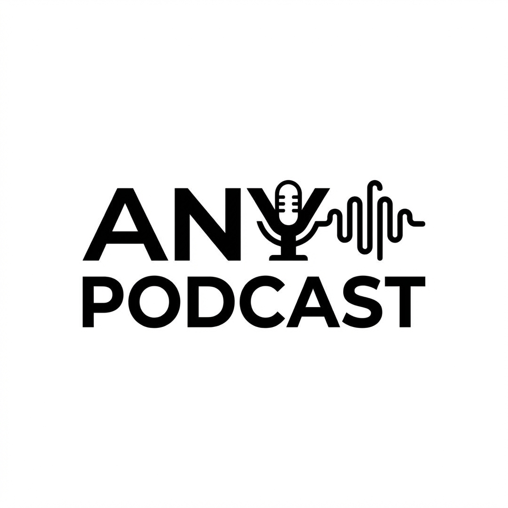

# Any Podcast



[中文](./README.zh-CN.md)

An AI-powered, configurable podcast platform that aggregates content sources, writes conversations from detailed article summaries, and produces podcast audio. You can define different sources per topic and build your own podcast flow.

## Philosophy

- Source-configurable, topic-agnostic
- Automation lowers the barrier to content creation
- Everyone should be able to run their own podcast pipeline

## Tech Stack

- **Runtime**: Next.js 15 (App Router) + Cloudflare Workers (via OpenNext)
- **AI**: OpenCode Go (DeepSeek Flash) / OpenAI / Gemini / MiniMax for content generation
- **TTS**: Edge TTS / MiniMax / Murf / Gemini TTS
- **Storage**: Cloudflare KV (metadata) + R2 (audio files)
- **UI**: Tailwind CSS + shadcn/ui

## Workflow Continuation Strategy (Subrequest Budget Guard)

To prevent `Too many subrequests` failures in long runs (many sources, many stories, many TTS lines), the project now uses a **single main workflow with continuation handoff**, instead of splitting logic into separate workflow types.

Core approach:

- Keep one `PodcastWorkflow` stage flow: `collect_candidates -> expand_gmail -> collect_articles -> summarize_articles -> compose_text -> tts_render -> done`
- Track a subrequest budget during execution (soft limit `45`, reserve `6`)
- Before high-cost work, estimate the next cost; if budget is near the threshold, checkpoint first and spawn a continuation instance
- The continuation is still the same main workflow, reusing the same `jobId` and incrementing `continuationSeq` (instance ID like `<jobId>-c<seq>`)

State and snapshot storage:

- **KV** stores lightweight workflow state (stage, cursor, progress, snapshot keys), under keys like `workflow:job:<jobId>:state`
- **R2** stores larger stage snapshots under keys like `workflow/jobs/<jobId>/*.json`
  - `candidates.json`: candidate stories and pending Gmail expansions
  - `articles.json`: complete article bodies and internal source metadata
  - `summaries.json`: detailed summaries and original-paragraph evidence references
  - `editorial-*.json`: draft/review decisions before publication
  - `compose.json`: composed podcast/blog text and TTS inputs

This allows the run to automatically continue in a fresh workflow instance before hitting the hard limit, without losing progress, while still producing one logical episode output.

## Getting Started

### Prerequisites

- [Node.js](https://nodejs.org/) >= 22.15
- [pnpm](https://pnpm.io/)
- A [Cloudflare](https://dash.cloudflare.com/) account
- An [OpenCode Go API key](https://opencode.ai/docs/go/) (or a key for another supported text provider)

### Step 1: Create Your Repository

Click **"Use this template"** on GitHub to create your own repository, then clone it locally:

```bash
git clone https://github.com/<your-username>/<your-repo>.git
cd <your-repo>
pnpm install
```

### Step 2: Create Cloudflare Resources

Log in to Cloudflare and create the required resources:

```bash
wrangler login

# Create a KV namespace
wrangler kv namespace create PODCAST_KV
# Note the returned namespace id

# Create an R2 bucket
wrangler r2 bucket create <your-podcast-name>
```

### Step 3: Configure Wrangler

Copy the template files and fill in your resource IDs:

```bash
cp wrangler.template.jsonc wrangler.jsonc
cp worker/wrangler.template.jsonc worker/wrangler.jsonc
```

Edit `wrangler.jsonc`:

- `name` — your podcast app name (e.g. `"my-podcast"`)
- `vars.PODCAST_ID` — your podcast identifier (e.g. `"my-podcast"`)
- `kv_namespaces[0].id` — the KV namespace ID from Step 2
- `r2_buckets[*].bucket_name` — the R2 bucket name from Step 2
- `services[0].service` — must match the worker name below

Edit `worker/wrangler.jsonc`:

- `name` — your worker name (e.g. `"my-podcast-worker"`)
- `vars.PODCAST_ID` — same as above
- `kv_namespaces[0].id` — same KV namespace ID
- `r2_buckets[0].bucket_name` — same R2 bucket name
- `triggers.crons` — when to auto-generate episodes (default: `"5 6 * * *"`, daily at 06:05 UTC)

> These files are listed in `.gitignore` because they contain account-specific resource IDs.

### Step 4: Configure Environment Variables

Copy the example files:

```bash
cp .env.local.example .env.local
cp worker/.env.local.example worker/.env.local
```

Edit `.env.local` (Next.js app):

| Variable             | Required | Description                                                                                                                           |
| -------------------- | -------- | ------------------------------------------------------------------------------------------------------------------------------------- |
| `PODCAST_ID`         | Yes      | Same as in wrangler config                                                                                                            |
| `ADMIN_TOKEN`        | Yes      | Password for the Admin console (choose a strong value)                                                                                |
| `NEXT_STATIC_HOST`   | Yes      | Base URL for audio files. Local dev: `http://localhost:3000/static`. Production: set in wrangler `vars` after deployment (see Step 7) |
| `NODE_ENV`           | No       | Defaults to `development` locally. Set to `production` in wrangler `vars`                                                             |
| `PODCAST_WORKER_URL` | No       | Worker URL used by the Admin trigger route in production when service binding is unavailable                                          |
| `TRIGGER_TOKEN`      | No       | Token used by the Admin trigger route when calling the Worker over HTTP in production                                                 |

Edit `worker/.env.local` (Worker):

| Variable                           | Required | Description                                                                                                      |
| ---------------------------------- | -------- | ---------------------------------------------------------------------------------------------------------------- |
| `PODCAST_ID`                       | Yes      | Same as above                                                                                                    |
| `OPENCODE_API_KEY`                 | Yes      | OpenCode Go API key (required for the default `ai.provider=opencode`; model `deepseek-v4.1-flash`)               |
| `OPENCODE_MODEL`                   | No       | Overrides the Admin OpenCode model when set; e.g. `deepseek-v4.1-flash`.                                         |
| `GEMINI_API_KEY`                   | No       | Google Gemini API key                                                                                            |
| `MINIMAX_API_KEY`                  | No       | MiniMax API key (if using MiniMax for text generation)                                                           |
| `ADMIN_TOKEN`                      | Yes      | Same as above                                                                                                    |
| `PODCAST_WORKER_URL`               | Yes      | Worker URL. Local dev: `http://localhost:8787`. Production: set in wrangler `vars` after deployment (see Step 7) |
| `PODCAST_R2_BUCKET_URL`            | Yes      | R2 bucket public URL. Local dev: `http://localhost:8787/static`. Production: your R2 custom domain or public URL |
| `OPENAI_API_KEY`                   | No       | OpenAI API key (if using OpenAI)                                                                                 |
| `CLOUDFLARE_ANYPODCAST_ACCOUNT_ID` | No       | Cloudflare account ID for markdown extraction. When configured, Cloudflare Markdown APIs are tried before Jina   |
| `CLOUDFLARE_ANYPODCAST_API_TOKEN`  | No       | Cloudflare API token for markdown extraction. Requires `Workers AI: Read` and `Browser Rendering: Edit` scopes   |
| `JINA_KEY`                         | No       | Jina API key (for web content extraction)                                                                        |
| `MINIMAX_TTS_GROUP_ID`             | No       | MiniMax TTS Group ID (required when `tts.provider=minimax`)                                                      |
| `MINIMAX_TTS_API_KEY`              | No       | MiniMax TTS API key (required when `tts.provider=minimax`)                                                       |
| `MURF_API_KEY`                     | No       | Murf API key (required when `tts.provider=murf`)                                                                 |
| `TRIGGER_TOKEN`                    | No       | Token for manually triggering the workflow via curl                                                              |
| `GMAIL_*`                          | No       | Gmail OAuth credentials (for newsletter sources)                                                                 |

Business runtime settings such as AI provider/model, workflow tests, sources, prompts and TTS are configured in Admin and stored in runtime config. `OPENCODE_MODEL` is an optional Worker environment override for the OpenCode model.

For backward compatibility, the Worker still accepts legacy `TTS_API_ID` / `TTS_API_KEY`, but new deployments should use the provider-specific names above.

### Step 5: Configure Your Podcast

There are **three ways** to configure your podcast content and behavior:

#### Option A: Admin Console (Recommended)

The web-based Admin console lets you configure everything at runtime without touching code:

1. Start the dev servers (see Step 6) or deploy first
2. Visit `/admin/login` and enter your `ADMIN_TOKEN`
3. Configure all settings in the UI:
   - **Site**: title, description, logo, theme color, contact email
   - **Hosts**: name, gender, persona, speaker marker for each host
   - **AI**: provider (OpenCode/Gemini/OpenAI/MiniMax) and model
   - **TTS**: provider (Gemini/Edge/MiniMax/Murf), language, voice for each host, audio quality, intro music
   - **Sources**: add RSS feeds, URLs, or Gmail labels
   - **Prompts**: customize all AI prompts (detailed article summaries, podcast dialogue, show notes, intro, title)
   - **Locale**: language, timezone

All changes are saved to KV and take effect immediately on the next workflow run.

#### Option B: Source Config File

For content sources, you can define them in code instead of (or in addition to) the Admin console:

```bash
cp workflow/sources/config.example.ts workflow/sources/config.local.ts
```

Edit `workflow/sources/config.local.ts` to add your RSS feeds, URLs, or Gmail labels. This file is gitignored and takes priority as the default source configuration.

#### Option C: Static Defaults in Code

The file `config.ts` contains static defaults for site metadata (title, description, SEO, theme). These are used as fallbacks when no runtime config exists in KV. For most cases, prefer configuring via the Admin console instead.

Cloudflare rendering remains the preferred article extractor. The two Spectrum Workers share a Durable Object hosted by the Chinese Worker to serialize render calls with at least 11 seconds between starts. This interval follows the tested account response (`429`, `Retry-After: 10`); retries also honor the server's requested delay. Public static HTML and Jina are fallbacks. Articles with no extracted body are skipped, and dialogue must preserve source facts.

Edge synthesis uses the read-aloud endpoint with its October 2026 v2 signature; the signature adaptation and LGPL notice are in `workflow/edge-drm/`. Segments run serially with a three-second pause and exponential retries. Continuations load their authoritative checkpoints from R2, with KV retaining the Admin progress view. Publication invalidates RSS snapshots after KV propagation; temporary audio is deleted in one batch.

Set the Worker variable `PODCAST_PUBLISH_MODE` to `preview` to generate audio and episode metadata under `previews/<jobId>/` without writing the public episode list or RSS. This hold also applies to scheduled runs. A preview job stays a preview across continuations. Use `publish` for new runs only after approving publication; the default when the variable is absent preserves the existing publication behavior.

Episode composition first prepares detailed, structured summaries of every complete article, then gives all relevant summaries to one dialogue request. Summaries retain identities, findings, numbers with statistical context, definitions, methods, cases, attributed viewpoints and limitations. Length follows the substantive information rather than a short fixed cap. Evidence references point to numbered original paragraphs; the original text remains in R2 for verification.

A separate reviewer receives the complete articles and draft, records a source-based check for every spoken turn (including statistical denominators and comparison objects), checks material factual and respect issues, and proposes only exact-turn corrections with valid source references. The workflow applies at most two repair rounds and rechecks each result. Review is best effort: after two repair rounds, or if the review service is unavailable or returns invalid edits, the workflow continues with the last usable script and records remaining issues. Editorial approval is not a publication gate. Empty scripts or broken speaker formatting remain technical failures. All DeepSeek text calls use thinking mode at high effort, including summaries, dialogue, review, title, description and show notes. Optional style suggestions do not force rewrites. Each draft, review and final decision is checkpointed in R2. `OPENCODE_REVIEW_MODEL` optionally selects a different reviewer; absent that, it uses the writing model. `pnpm deploy:providers` deploys both model settings.

Only `source`, `title` and `content` are sent as article metadata, with URL destinations removed. Navigation and footers remain for the model to recognize, without page-specific cropping. Complete articles and detailed summaries support continuation recovery; `replayMaterialJobId` reuses saved originals and makes fresh summaries. No retry silently truncates articles or drops them to a six-story subset. Public citations are added after show-note generation from internal URL metadata.

A text-only automated test, without TTS or publication:

```bash
OPENCODE_REVIEW_MODEL=deepseek-v4-pro pnpm podcast:script-preview existing-config.json articles.json tmp/script-preview
```

`articles.json` is an array of `{source,title,content}` or an object containing an `articles` array. The test saves detailed summaries, original model drafts, every review, and `dialogue.txt` for the final usable version. Use `--draft existing-draft.txt` to run the same automatic checks and repairs on an existing model draft. The exported `prompts.json` contains only the three prompts to merge into an existing Admin configuration; hosts, sources, title style and other settings remain under that configuration. Deploy existing shows with these prompt updates together with the code.

### Generate a local preview with OpenCode Go and Edge TTS

Add `OPENCODE_API_KEY=your_key` and `OPENCODE_MODEL=deepseek-v4.1-flash` to `worker/.env.local`. `OPENCODE_MODEL` takes precedence over the Admin model for OpenCode; omit it to use the Admin setting. It accepts models using the OpenCode Go Chat Completions endpoint. Edge TTS needs no key. The default text model is `deepseek-v4.1-flash`, using the [OpenCode Go Chat Completions endpoint](https://opencode.ai/docs/go/#endpoints).

The language presets use native, single-language voices at normal speed:

| Language | First/male host     | Second/female host     |
| -------- | ------------------- | ---------------------- |
| Chinese  | `zh-CN-YunxiNeural` | `zh-CN-XiaoxiaoNeural` |
| English  | `en-US-GuyNeural`   | `en-US-JennyNeural`    |

For an existing podcast, save the authenticated Admin `GET /api/admin/config/draft` response locally, then prepare a new configuration. This preserves its hosts, sources, editorial prompts and intro music. A provider switch resets the old TTS model, endpoint and speed; Edge speed is a percentage (`+0%` is normal), rather than MiniMax's multiplier.

```bash
pnpm podcast:configure existing-config.json tmp/preview/config.json
pnpm test:providers
pnpm tts:smoke

# Test the actual Cloudflare Worker runtime in a second terminal:
pnpm tts:worker
pnpm tts:smoke http://localhost:8799

# articles.json is an array of { "title": "...", "link": "https://...", "content": "..." }
pnpm podcast:preview tmp/preview/config.json articles.json tmp/preview/episode http://localhost:8799 https://your-podcast-worker.example.workers.dev
```

The preview summarizes complete articles in detail, writes and automatically reviews the dialogue, then generates the title, description and show notes, synthesizes each host’s speech, concatenates MP3 segments and mixes intro music. It saves `podcast.mp3`, `dialogue.txt`, `show-notes.md`, and `manifest.json`, and requires a successful full audio decode. Omit the local Worker URL to synthesize in Node. The final URL argument resolves relative intro music URLs; it defaults to `PODCAST_WORKER_URL` from `worker/.env.local`.

For the two Spectrum deployments, `pnpm deploy:providers` securely uploads `OPENCODE_API_KEY` and `OPENCODE_MODEL` from `worker/.env.local` to both existing Workers. Pass `cn` or `en` to update one. Run it again after changing the key or model locally. An empty model restores the Admin setting.

These commands only create local files. Existing KV configurations keep taking precedence over code defaults; updating code alone does not migrate a live podcast. After reviewing the preview, update that podcast's Worker secret and Admin AI/TTS settings when deploying.

### Step 6: Local Development

```bash
# Start the Next.js dev server (port 3000)
pnpm dev

# Start the Worker dev server (port 8787) in another terminal
pnpm dev:worker

# Trigger the workflow manually
curl -X POST http://localhost:8787
```

### Step 7: Deploy

```bash
# Deploy the Worker first
pnpm deploy:worker
# The CLI will print the Worker URL, e.g. https://my-podcast-worker.<your-subdomain>.workers.dev

# Set production secrets for the Worker
wrangler secret put OPENCODE_API_KEY --cwd worker
wrangler secret put ADMIN_TOKEN --cwd worker
# Add other secrets as needed (OPENAI_API_KEY, MINIMAX_TTS_API_KEY, MURF_API_KEY, etc.)

# Deploy the Next.js app
pnpm run deploy
# The CLI will print the app URL, e.g. https://my-podcast.<your-subdomain>.workers.dev
```

After the first deploy, you need to set the production URLs that weren't known beforehand. Add them to the `vars` section of your wrangler config files, then redeploy:

In `wrangler.jsonc` (Next.js app), add to `vars`:

```jsonc
{
  "NEXT_STATIC_HOST": "https://my-podcast.<your-subdomain>.workers.dev/static",
  "PODCAST_WORKER_URL": "https://my-podcast-worker.<your-subdomain>.workers.dev"
}
```

In `worker/wrangler.jsonc` (Worker), add to `vars`:

```jsonc
{
  "PODCAST_WORKER_URL": "https://my-podcast-worker.<your-subdomain>.workers.dev",
  "PODCAST_R2_BUCKET_URL": "https://<your-r2-public-url>",
  "PODCAST_SITE_URL": "https://my-podcast.<your-subdomain>.workers.dev"
}
```

Set `PODCAST_SITE_SERVICE` in the Worker’s `services` to the frontend Worker name. Keep `PUBLIC_PAGE_RENDERER` and its migration in the frontend config; the templates include both bindings.

Then redeploy both: `pnpm deploy:worker && pnpm run deploy`

> You can also set custom domains for your app and Worker in the Cloudflare dashboard, then use those domains in the vars above.

After deployment:

1. Your app URL is printed by the deploy command, or find it in the [Cloudflare dashboard](https://dash.cloudflare.com/) under Workers & Pages
2. Go to `/admin` to configure your podcast via the Admin console
3. Trigger the first episode from the **Admin console**: go to `/admin`, switch to the **Testing** tab, and click **Trigger Workflow** — or use curl: `curl -X POST <your-worker-url>`
4. The Worker's cron trigger automatically generates new episodes on schedule. The default is daily at 06:05 UTC — configure this in `worker/wrangler.jsonc` under `triggers.crons` using [standard cron syntax](https://developers.cloudflare.com/workers/configuration/cron-triggers/)

### Public pages and cache updates

Public HTML and RSS reads use the lightweight `site-entry.mjs` entry point before loading Next.js. Public documents are cached in R2; Admin edits invalidate them, and publication clears and warms the episode page, homepage and RSS. Keep this entry point in Wrangler configuration when deploying. Checks: `pnpm test:unit`.

Cache misses, including first visits and client-side navigation, are rendered by `PublicPageRenderer` (a SQLite Durable Object), rather than the edge Worker. After publication the workflow waits for KV propagation, invalidates all page/feed host caches, and uses `PODCAST_SITE_SERVICE` with `PODCAST_SITE_URL` to warm and verify the episode page, homepage and RSS. A missing binding or unsuccessful verification fails the step and triggers retries.

## Running Multiple Podcasts

You can run multiple independent podcasts from the same codebase. Each podcast is a separate Cloudflare deployment with its own configuration. No code changes required.

### Setup

1. Create additional Cloudflare resources (KV namespace, R2 bucket) for the new podcast

2. Create named wrangler config files for each podcast:

```bash
# For a podcast named "my-second"
cp wrangler.template.jsonc wrangler.my-second.jsonc
cp worker/wrangler.template.jsonc worker/wrangler.my-second.jsonc
```

3. Fill in the new resource IDs and podcast name in both files

4. Add the new config files to `.gitignore` (they contain account-specific IDs)

### Switching Between Podcasts

The Next.js dev server (`pnpm dev`) always reads `wrangler.jsonc`. To switch which podcast is active locally, add convenience scripts to `package.json`:

```json
{
  "scripts": {
    "use:first": "cp wrangler.my-first.jsonc wrangler.jsonc && cp worker/wrangler.my-first.jsonc worker/wrangler.jsonc && echo 'Switched to my-first'",
    "use:second": "cp wrangler.my-second.jsonc wrangler.jsonc && cp worker/wrangler.my-second.jsonc worker/wrangler.jsonc && echo 'Switched to my-second'"
  }
}
```

Then switch and work as usual:

```bash
pnpm use:second      # Switch to second podcast
pnpm dev:worker      # Start Worker dev server
pnpm dev             # Start Next.js dev server
```

### Deploying

Switch to the target podcast before deploying:

```bash
pnpm use:second      # Switch config
pnpm deploy:worker   # Deploy this podcast's Worker
pnpm run deploy      # Deploy this podcast's Next.js app
```

Each deployment has its own independent Admin page, prompts, TTS settings, content sources, and data. Configure each podcast via its own Admin console after deployment.

> Each podcast instance reads `PODCAST_ID` from its wrangler config, and all data in KV/R2 is namespaced by podcast ID.

## Commands

| Command              | Description                                                                                |
| -------------------- | ------------------------------------------------------------------------------------------ |
| `pnpm dev`           | Start Next.js dev server (port 3000)                                                       |
| `pnpm dev:worker`    | Start Worker dev server (port 8787)                                                        |
| `pnpm build`         | Build the Next.js app                                                                      |
| `pnpm run deploy`    | Build and deploy the Next.js app                                                           |
| `pnpm deploy:worker` | Deploy the Worker                                                                          |
| `pnpm logs:worker`   | Tail Worker logs                                                                           |
| `pnpm use:<name>`    | Switch active podcast config (see [Running Multiple Podcasts](#running-multiple-podcasts)) |
| `pnpm lint:fix`      | Auto-fix ESLint issues                                                                     |
| `pnpm tests`         | Run integration tests (requires remote)                                                    |

## Origin

This project evolved from [hacker-podcast](https://github.com/miantiao-me/hacker-podcast). Thanks to the original author for open-sourcing it.
